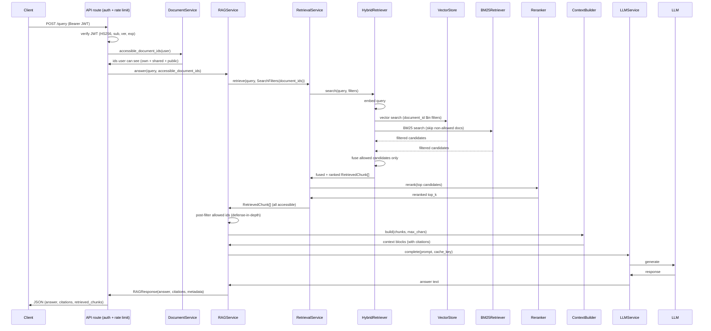
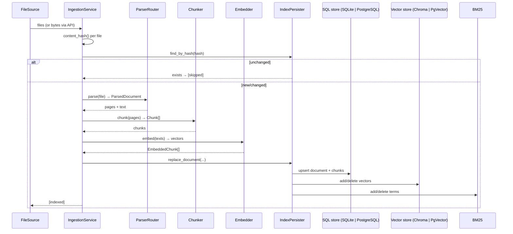

# Architecture

The system is a layered pipeline divided into four concentric layers selected by dependency
inversion: **domain**, **application**, **infrastructure**, and **delivery** (API/CLI/composition
root). Services hold references only to interfaces; all concrete wiring happens in one module,
`app/bootstrap.py`.

```
┌─────────────────────────────── delivery ───────────────────────────────┐
│  api/routes/* (FastAPI)      __main__ (CLI)       bootstrap (wiring)   │
│  auth deps (get_current_user, enforce_rate_limit)                      │
└───────────────────────────────────────┬────────────────────────────────┘
                                        │ depends on
┌─────────────────────────────── application ────────────────────────────┐
│  RAGService  RetrievalService  IngestionService  LLMService            │
│  AuthService  DocumentService  ContextBuilder  PromptBuilder           │
│  RewriteService  RateLimiter                                           │
│  (orchestration, no framework imports)                                 │
└───────────────────────────────────────┬────────────────────────────────┘
                                        │ depends on (all Protocols)
┌─────────────────────────────── domain ─────────────────────────────────┐
│  entities / value_objects / exceptions                                  │
│  interfaces.py (incl. QueryRewriter, Cache)                             │
└────────────────────┼────────────┼──────────────┼────────────────────────┘
                     ▼            ▼              ▼
┌─────────────────────────────── infrastructure ─────────────────────────┐
│  DocumentParserRouter  Chunker  Embedder  VectorStore  BM25  Reranker   │
│  SQLAlchemyRepository  SQLAlchemyUserRepository  IndexPersister        │
│  ChromaVectorStore | PgVectorStore  CachingVectorStore                 │
│  LLM backends (echo | ollama | nemotron)   rewriters (heuristic|llm)   │
│  InMemoryCache | RedisCache  SingleFlight  IndexGeneration             │
└─────────────────────────────────────────────────────────────────────────┘
```

## Layering rules

- **Domain** (`app/domain/`) — the vocabulary: `ParsedDocument`, `Chunk`, `EmbeddedChunk`,
  `RetrievedChunk`, `Citation`, `RAGResponse`, `SearchFilters`, `ConfigurableFusion`,
  `RewrittenQuery`; exceptions hierarchy rooted at `RAGError`; and the `Protocol` interfaces every
  collaborator implements: `DocumentParser`, `Chunker`, `Embedder`, `VectorStore`,
  `DocumentRepository`, `UserRepository`, `LexicalRetriever`, `Persister`, `HybridSearch`,
  `Reranker`, `LLM`, `QueryRewriter`, `FileSource` (plus the `Cache` protocol in
  `app/common/cache`). Application services depend only on these.
- **Application** (`app/application/`) — pure orchestration. Services receive interfaces and
  combination-config and never import a framework. This is where test doubles are also injected.
  `AuthService` (registration/login/JWT issuance + per-user `token_version` revocation),
  `DocumentService` (ownership, CRUD, sharing), `RewriteService` (strategy selection + fail-open
  rewriter chain) and `RateLimiter` (per-user fixed-window cost guardrail) sit alongside the RAG
  services; query access-control ids are pushed down into retrieval as
  `SearchFilters.document_ids` (post-filtering remains only as a defense-in-depth safety net).
- **Infrastructure** (`app/infrastructure/`) — concrete adapters: PyMuPDF/Text parsers,
  sentence-aware chunker, sentence-transformers embedder, Chroma/PgVector vector stores,
  `CachingVectorStore` wrapper (generation-keyed + stampede-safe), BM25Retriever/hybrid retrievers,
  cross-encoder reranker, SQLAlchemy persistence (`users` incl. `token_version`, `documents.owner_id`,
  `document_shares`), echo/ollama/NIM (Nemotron) LLMs — NIM clients share an abstract
  `NIMClientBase` — and heuristic/LLM query rewriters.
- **Cross-cutting config & caching** — `ConfigurableFusion` (domain) carries only the fusion
  strategy/weights; the RRF/weighted algorithm itself lives in `app/common/utils/fusion.py`
  so the domain owns the config, not the math. All caches speak one `Cache` protocol
  (`get`/`set`/`delete`/`clear`) with two backends: bounded in-process `InMemoryCache` and
  `RedisCache`. Backing store is chosen by `CACHE_BACKEND` (memory|redis) per `CACHE_ENABLED`,
  applied to the LLM-response (`llm:`), rewrite (`rewrite:`) and rate-limit (`rl:`) namespaces.
  `CachingVectorStore` is a separate opt-in layer with its own generation counter +
  `SingleFlight` stampede protection. Tokens are standard HS256 JWTs (algorithm pinned on
  verification) — see `docs/access_control.md`.
- **Delivery** — `api/` exposes REST endpoints (auth dependencies resolve the JWT into a `User`
  and, on `/query`+`/rewrite`, enforce the per-user rate limit); `__main__.py` exposes the CLI;
  `bootstrap.py` is the single composition root.

## Dependency graph (runtime)

```mermaid
graph LR
  subgraph Delivery
    API
    CLI
    Bootstrap
  end

  subgraph Application
    IS[IngestionService]
    RS[RetrievalService]
    RAG[RAGService]
    LS[LLMService]
    CB[ContextBuilder]
    PB[PromptBuilder]
    AS[AuthService]
    DS[DocumentService]
    RW[RewriteService]
    RL[RateLimiter]
  end

  subgraph Infrastructure
    Parser[DocumentParserRouter]
    Chunk[Chunker]
    Emb[Embedder]
    VS[VectorStore]
    VC[CachingVectorStore]
    BM[BM25Retriever]
    H[HybridRetriever]
    RR[Reranker]
    DB[(SQLite | PostgreSQL + pgvector)]
    USR[(users + document_shares + token_version)]
    IP[IndexPersister]
    LLM[LLM backends: echo | ollama | nemotron]
    RWR[rewriters: heuristic | llm]
    CACHE[InMemoryCache | RedisCache]
  end

  Bootstrap --> Parser
  Bootstrap --> Chunk
  Bootstrap --> Emb
  Bootstrap --> VS
  Bootstrap --> BM
  Bootstrap --> DB
  Bootstrap --> USR
  Bootstrap --> RR
  Bootstrap --> LLM
  Bootstrap --> CACHE

  IS --> Parser
  IS --> Chunk
  IS --> Emb
  IS --> IP

  IP --> DB
  IP --> VS
  IP --> BM

  VC --> VS
  H --> VC
  H --> Emb
  H --> BM

  RS --> H
  RS --> RR

  RAG --> RS
  RAG --> CB
  RAG --> PB
  RAG --> LS
  RAG -->|opt. gate QUERY_REWRITE_ENABLED| RW

  RW --> RWR
  RW --> CACHE

  LS --> LLM
  LS --> CACHE

  API --> RAG
  API --> IS
  API --> AS
  API --> DS
  API --> RL
  API --> RW
  RL --> CACHE

  AS -->|UserRepository| USR
  DS -->|DocumentRepository| DB
  DS -->|UserRepository| USR
  CLI --> RAG
  CLI --> IS
  CLI --> EP[EvaluationRunner]
```

> **Access-control wiring**: the API route — not `RAGService` — calls
> `DocumentService.accessible_document_ids(user)` and passes the set into
> `RAGService.answer()`, which forwards it to retrieval as `SearchFilters.document_ids`.
> The `user` comes from a verified HS256 JWT — the `sub` claim is looked up in the user
> store and the token's `ver` claim must equal the user's `token_version` (revocation).
> The sequence diagrams below are the authoritative contracts.

## Request/response flow (single query)



## Request/response flow (query rewriting enabled)

```
Client → API route (auth + rate limit)
  → RAGService.answer(query, rewrite=True) — gate: QUERY_REWRITE_ENABLED or per-request override
  → RewriteService.rewrite(query) → one RewrittenQuery with N variants
       (LLM rewriter → heuristic fallback → passthrough; strategy is recorded)
  → RetrievalService.retrieve_multi(rewritten, filters)
       fan out: for each variant → HybridRetriever.search(variant, SAME SearchFilters)
       merge variants (RRF / weighted)
       rerank merged candidates → dedupe
  → ContextBuilder → LLMService.generate → RAGResponse(metadata.rewritten_variants,
       metadata.rewrite_strategy) → JSON response
```
Access control is identical to the single-query flow: the **same** resolved
`SearchFilters.document_ids` reach every variant, and the post-filter safety net still runs.

## Ingestion flow



## Composability & testability

`build_container(settings=None, *, with_reranker=True, embedder=None, vector_store=None,
llm=None, llm_providers=None)` accepts injected doubles for the three heavy pieces (embedder,
vector store, LLM); `llm_providers` overlays the `name → LLM` registry (used by tests to
inject a fake backend without touching the network). Integration tests inject
`FakeEmbedder`/real Chroma; the `echo` LLM keeps the whole pipeline offline-testable. The
general cache (`llm:`/`rewrite:`/`rl:` namespaces) defaults to `InMemoryCache`; rate limiting
is on by default but no-ops when the cache is disabled/unavailable. Every service can also be
constructed directly with fakes for unit tests — there are no hidden globals or module-level
singletons inside components (only `get_settings()` exists at the composition root).

The default test/CI run exercises the **Chroma** backend end-to-end; the pgvector vector store
is covered by `tests/integration/test_pgvector.py`, which is skipped unless
`RAG_TEST_POSTGRES_URL` points at a live PostgreSQL+pgvector instance. Because the two stores
use different filter syntax (Chroma `$in`/`$eq` metadata vs. pgvector SQL `IN`), keep both
backends in the test matrix for any change to `SearchFilters` handling.