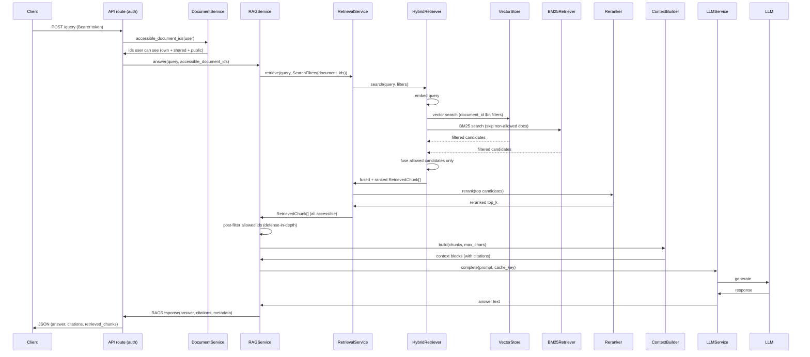
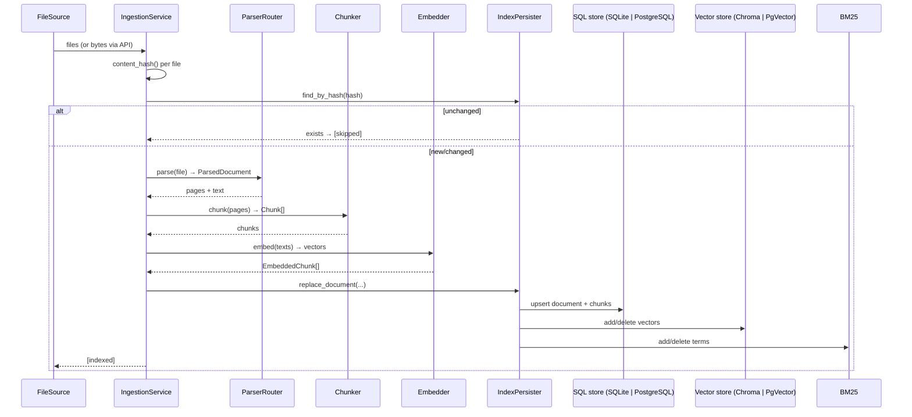

# Architecture

The system is a layered pipeline divided into four concentric layers selected by dependency
inversion: **domain**, **application**, **infrastructure**, and **delivery** (API/CLI/composition
root). Services hold references only to interfaces; all concrete wiring happens in one module,
`app/bootstrap.py`.

```
┌─────────────────────────────── delivery ───────────────────────────────┐
│  api/routes/* (FastAPI)      __main__ (CLI)       bootstrap (wiring)   │
└───────────────────────────────────────┬────────────────────────────────┘
                                        │ depends on
┌─────────────────────────────── application ────────────────────────────┐
│  RAGService  RetrievalService  IngestionService  LLMService            │
│  AuthService  DocumentService  ContextBuilder  PromptBuilder           │
│  (orchestration, no framework imports)                                 │
└───────────────────────────────────────┬────────────────────────────────┘
                                        │ depends on (all Protocols)
┌─────────────────────────────── domain ─────────────────────────────────┐
│  entities / value_objects / exceptions                                  │
│  interfaces.py     │            │              │                        │
└────────────────────┼────────────┼──────────────┼────────────────────────┘
                     ▼            ▼              ▼
┌─────────────────────────────── infrastructure ─────────────────────────┐
│  DocumentParserRouter  Chunker  Embedder  VectorStore  BM25  Reranker   │
│  SQLAlchemyRepository  SQLAlchemyUserRepository  IndexPersister        │
│  ChromaVectorStore | PgVectorStore   LLM backends                      │
└─────────────────────────────────────────────────────────────────────────┘
```

## Layering rules

- **Domain** (`app/domain/`) — the vocabulary: `ParsedDocument`, `Chunk`, `EmbeddedChunk`,
  `RetrievedChunk`, `Citation`, `RAGResponse`, `SearchFilters`, `ConfigurableFusion`; exceptions
  hierarchy rooted at `RAGError`; and the `Protocol` interfaces every collaborator implements:
  `DocumentParser`, `Chunker`, `Embedder`, `VectorStore`, `DocumentRepository`, `UserRepository`,
  `LexicalRetriever`, `Persister`, `HybridSearch`, `Reranker`, `LLM`, `FileSource` (plus `Cache`
  in `app/common/cache` for LLM caching). Application services depend only on these.
- **Application** (`app/application/`) — pure orchestration. Services receive interfaces and
  combination-config and never import a framework. This is where test doubles are also injected.
  `AuthService` (registration/login/tokens) and `DocumentService` (ownership, CRUD, sharing)
  sit alongside the RAG services; query access-control ids are pushed down into retrieval as
  `SearchFilters.document_ids` (post-filtering remains only as a defense-in-depth safety net).
- **Infrastructure** (`app/infrastructure/`) — concrete adapters: PyMuPDF/Text parsers,
  sentence-aware chunker, sentence-transformers embedder, Chroma vector store,
  BM25Retriever/hybrid retrievers, cross-encoder reranker, SQLAlchemy persistence (`users`,
  `documents.owner_id`, `document_shares`), echo/ollama/NIM (Nemotron) LLMs — NIM clients share
  an abstract `NIMClientBase`.
- **Cross-cutting config** — `ConfigurableFusion` (domain) carries only the fusion
  strategy/weights; the RRF/weighted algorithm itself lives in `app/common/utils/fusion.py`
  so the domain owns the config, not the math. `LLMService` wraps LLM calls in an
  `InMemoryCache` (`Cache` protocol, `CACHE_ENABLED`/`CACHE_MAX_ENTRIES`) — in-memory only,
  does not survive restarts.
- **Delivery** — `api/` exposes REST endpoints; `__main__.py` exposes the CLI; `bootstrap.py`
  is the single composition root.

## Dependency graph (runtime)

```mermaid
graph LR
  subgraph Delivery
    API
    CLI
    Bootstrap
  end

  subgraph Application
    IS[IngestionService]
    RS[RetrievalService]
    RAG[RAGService]
    LS[LLMService]
    CB[ContextBuilder]
    PB[PromptBuilder]
    AS[AuthService]
    DS[DocumentService]
  end

  subgraph Infrastructure
    Parser[DocumentParserRouter]
    Chunk[Chunker]
    Emb[Embedder]
    VS[ChromaVectorStore | PgVectorStore]
    BM[BM25Retriever]
    H[HybridRetriever]
    RR[Reranker]
    DB[(SQLite | PostgreSQL + pgvector)]
    USR[(users + document_shares)]
    IP[IndexPersister]
    LLM[LLM backend]
    CACHE[InMemoryCache]
  end

  Bootstrap --> Parser
  Bootstrap --> Chunk
  Bootstrap --> Emb
  Bootstrap --> VS
  Bootstrap --> BM
  Bootstrap --> DB
  Bootstrap --> USR
  Bootstrap --> RR
  Bootstrap --> LLM

  IS --> Parser
  IS --> Chunk
  IS --> Emb
  IS --> IP

  IP --> DB
  IP --> VS
  IP --> BM

  H --> VS
  H --> Emb
  H --> BM

  RS --> H
  RS --> RR
  RAG --> RS
  RAG --> CB
  RAG --> PB
  RAG --> LS
  LS --> LLM
  LS --> CACHE

  API --> RAG
  API --> IS
  API --> AS
  API --> DS
  AS -->|UserRepository| USR
  DS -->|DocumentRepository| DB
  DS -->|UserRepository| USR
  CLI --> RAG
  CLI --> IS
  CLI --> EP[EvaluationRunner]
```

> **Access-control wiring**: the API route — not `RAGService` — calls
> `DocumentService.accessible_document_ids(user)` and passes the set into
> `RAGService.answer()`, which forwards it to retrieval as `SearchFilters.document_ids`.
> The sequence diagram below is the authoritative contract.

## Request/response flow



## Ingestion flow



## Composability & testability

`build_container(settings=None, *, with_reranker=True, embedder=None, vector_store=None,
llm=None, llm_providers=None)` accepts injected doubles for the three heavy pieces (embedder,
vector store, LLM); `llm_providers` overlays the `name → LLM` registry (used by tests to
inject a fake backend without touching the network). Integration tests inject
`FakeEmbedder`/real Chroma; the `echo` LLM keeps the whole pipeline offline-testable. Every
service can also be constructed directly with fakes for unit tests —
there are no hidden globals or module-level singletons inside components (only
`get_settings()` exists at the composition root).

The default test/CI run exercises the **Chroma** backend end-to-end; the pgvector vector store
is covered by `tests/integration/test_pgvector.py`, which is skipped unless
`RAG_TEST_POSTGRES_URL` points at a live PostgreSQL+pgvector instance. Because the two stores
use different filter syntax (Chroma `$in`/`$eq` metadata vs. pgvector SQL `IN`), keep both
backends in the test matrix for any change to `SearchFilters` handling.